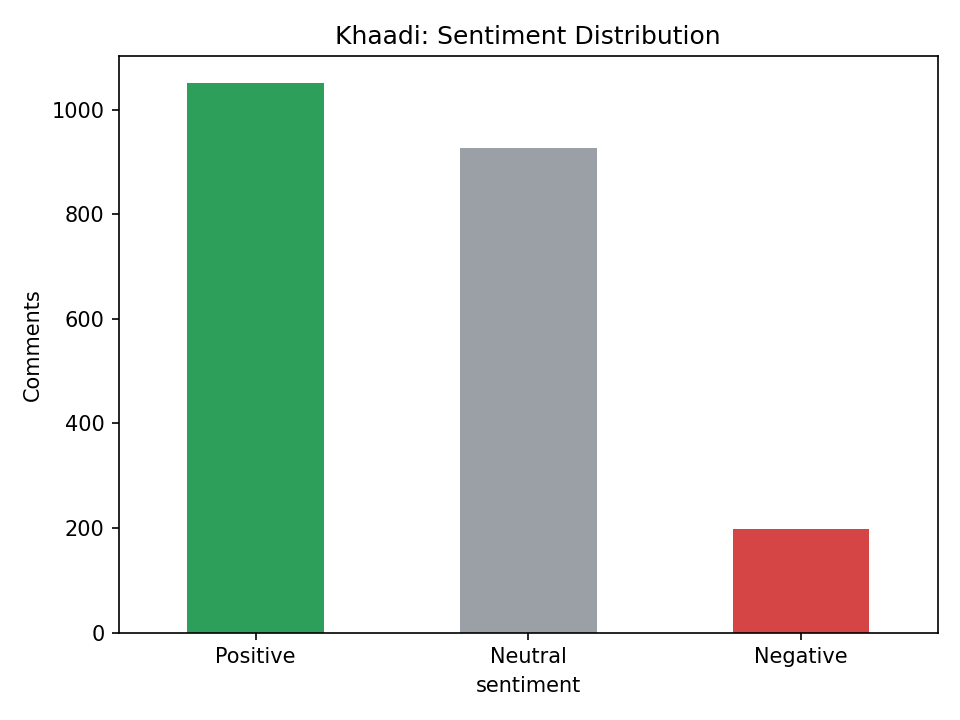
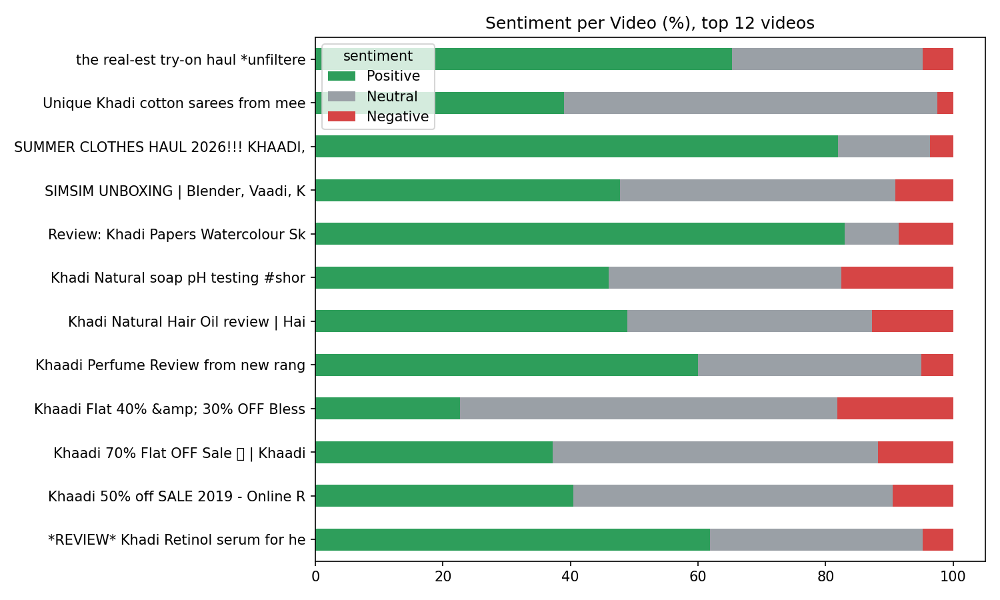
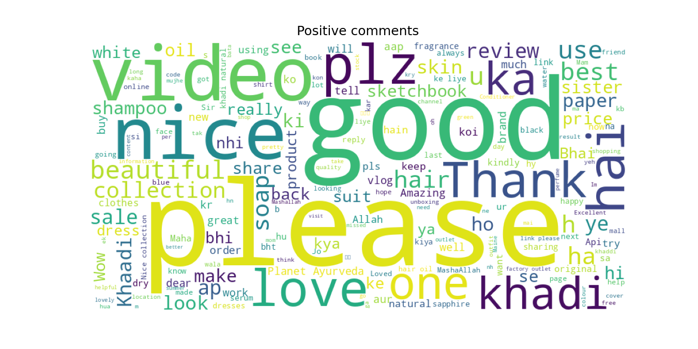
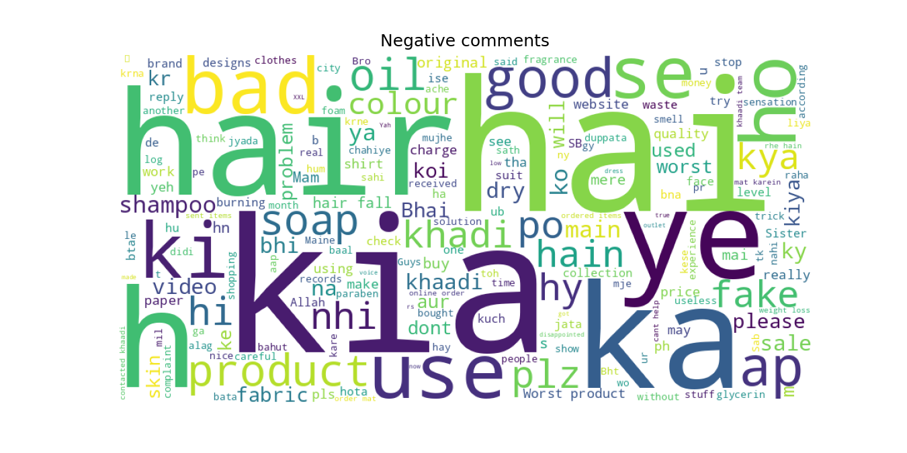

# Brand Sentiment Analysis from YouTube Comments

A sentiment analysis project that collects public YouTube comments about a clothing brand using the **YouTube Data API v3** and classifies them as **Positive**, **Neutral** or **Negative**. It also generates charts and word clouds to show what customers like and dislike.

## Features
- Searches YouTube for videos about any brand (e.g. *"Khaadi review"*)
- Scrapes comments using the official YouTube Data API
- Cleans text (removes links, mentions, extra spaces)
- Sentiment classification with two options:
  - **VADER**: fast, works best on English
  - **XLM-RoBERTa** (`cardiffnlp/twitter-xlm-roberta-base-sentiment`): multilingual
- Visualisations: sentiment distribution, per-video breakdown, positive/negative word clouds
- Exports results as CSV

## Tech Stack
Python, Pandas, Matplotlib, WordCloud, VADER, Hugging Face Transformers, Google API Client, Google Colab

## Project Structure
```
.
├── Brand_Sentiment_Analysis.ipynb   # All-in-one Colab notebook (easiest way to run)
├── scrape_youtube.py                # Step 1: scrape comments (local use)
├── analyze.py                       # Step 2: sentiment analysis + charts (local use)
├── requirements.txt
├── .env.example                     # Template for your API key
└── README.md
```

## Getting Started

### 1. Get a YouTube API key
1. Open [Google Cloud Console](https://console.cloud.google.com) and create a project.
2. Enable **YouTube Data API v3** (APIs & Services > Library).
3. Create an **API key** (APIs & Services > Credentials).

### 2a. Run on Google Colab (recommended)
1. Open [Google Colab](https://colab.research.google.com) > **File > Upload notebook** > select `Brand_Sentiment_Analysis.ipynb`.
2. In Cell 2, set `BRAND` to your brand name.
3. Click **Runtime > Run all** and paste your API key when asked.
4. Results download as `results.zip`.

### 2b. Run locally
```bash
pip install -r requirements.txt
cp .env.example .env          # then add your API key inside .env

python scrape_youtube.py --brand "Khaadi" --videos 10 --max-comments 300
python analyze.py --input data/comments.csv --model vader
```
Outputs are saved in the `output/` folder.

## Results
   

**Key findings:**
- Analysed 158 YouTube comments about [Brand name] using VADER sentiment analysis.
- Overall sentiment was mostly positive: 62.0% positive (98 comments), 32.9% neutral (52 comments) and 5.1% negative (8 comments).
- Negative comments were very few, so no reliable complaint patterns can be drawn from them.
- The dataset is small (158 comments), so these results show a general trend rather than a final conclusion.
- VADER is designed for English, so Roman Urdu and mixed-language comments may be classified as neutral or misclassified. The neutral share may therefore be overstated.

## Limitations
- VADER is trained on English and is less accurate on Roman Urdu / mixed-language comments.
- Comments are only from the videos returned by YouTube search, so results may not represent all customers.
- Very short comments (e.g. "ok") can be misclassified.
- YouTube API free quota is 10,000 units/day.

## Future Work
- Fine-tune a model on hand-labelled Roman Urdu comments
- Compare multiple brands
- Track sentiment over time
- Add Instagram / Facebook data sources

## Security Note
Never commit your API key. The `.env` file is listed in `.gitignore`.

## License
MIT
