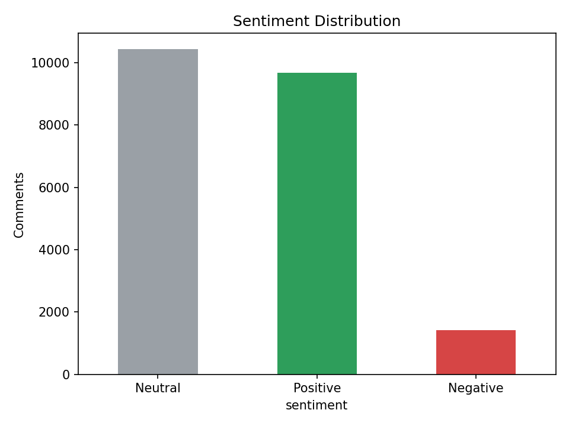
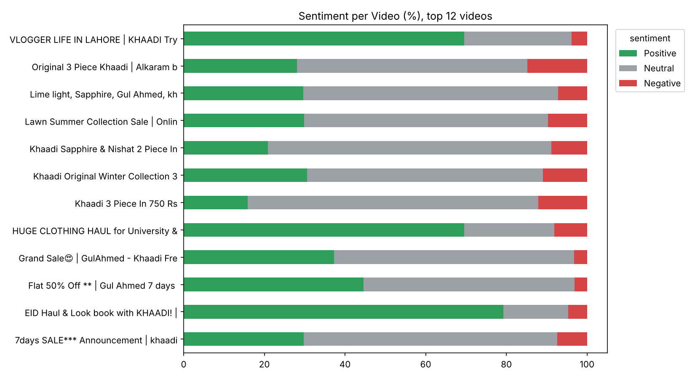
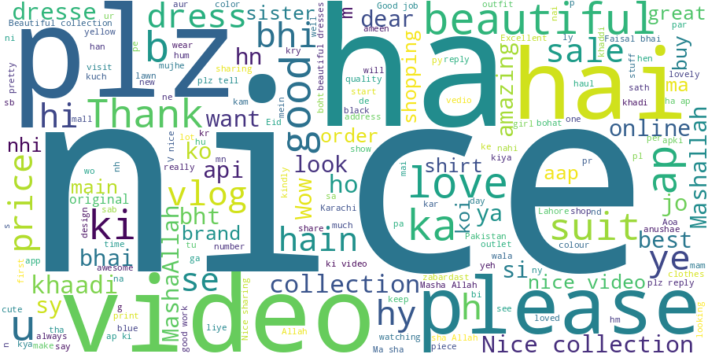
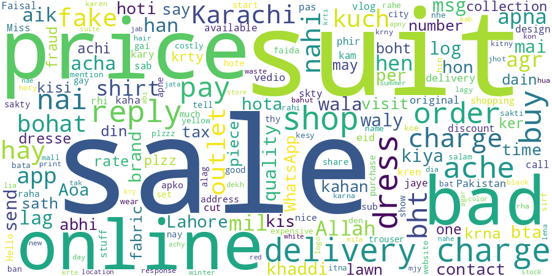

# Brand Sentiment Analysis from YouTube Comments

A sentiment analysis project that collects public YouTube comments about a clothing brand (**Khaadi clothing only**) using the **YouTube Data API v3** and classifies them as **Positive**, **Neutral** or **Negative**. It also generates charts and word clouds to show what customers like and dislike.

## Features
- Searches YouTube with 12 clothing queries (sale, lawn, Eid collection, haul, try-on, unboxing ...) and filters video titles so only Khaadi **clothing** videos remain (perfume, "Khadi" herbal/stationery and IPO videos are rejected)
- Saves video statistics too: views, video likes, publish date, URL, collection date
- Scrapes comments using the official YouTube Data API
- Cleans text (removes links, mentions, extra spaces)
- Sentiment classification with two options:
  - **VADER**: fast, works best on English
  - **XLM-RoBERTa** (`cardiffnlp/twitter-xlm-roberta-base-sentiment`): multilingual
- Visualisations: sentiment distribution, per-video breakdown, positive/negative word clouds
- Exports results as CSV

## Tech Stack
Python, Pandas, Matplotlib, WordCloud, VADER, Hugging Face Transformers, Google API Client, Google Colab

## Project Structure
```
.
├── Brand_Sentiment_Analysis.ipynb   # All-in-one Colab notebook (easiest way to run)
├── scrape_youtube.py                # Step 1: scrape clothing-video comments (local use)
├── analyze.py                       # Step 2: sentiment analysis + charts (local use)
├── requirements.txt
├── .env.example                     # Template for your API key
└── README.md
```

## Getting Started

### 1. Get a YouTube API key
1. Open [Google Cloud Console](https://console.cloud.google.com) and create a project.
2. Enable **YouTube Data API v3** (APIs & Services > Library).
3. Create an **API key** (APIs & Services > Credentials).

### 2a. Run on Google Colab (recommended)
1. Open [Google Colab](https://colab.research.google.com) > **File > Upload notebook** > select `Brand_Sentiment_Analysis.ipynb`.
2. In Cell 2, check the settings (`BRAND`, `COMMENTS_PER_VIDEO`, `ORDER`).
3. Click **Runtime > Run all** and paste your API key when asked.
4. Results download as `results.zip`.

### 2b. Run locally
```bash
pip install -r requirements.txt
cp .env.example .env          # then add your API key inside .env

python scrape_youtube.py --dry-run                      # quota estimate only
python scrape_youtube.py --order viewCount --max-comments 500 --out data/comments_clothing.csv
python analyze.py --input data/comments_clothing.csv --model vader
```
Outputs are saved in the `output/` folder.

## Results
  


**Key findings (collected 12 Nov 2026):**
- Analysed **21,514 YouTube comments on 571 Khaadi clothing videos** (126 channels) using VADER sentiment analysis.
- Overall sentiment: 45.0% positive (9,672 comments), 48.5% neutral (10,426 comments) and 6.6% negative (1,416 comments).
- Negative comments are a small minority; the neutral share is high because many comments are short, emoji-only or written in Roman Urdu, which VADER (designed for English) often scores as neutral. Many neutral comments are really questions (price, address, sale date).
- The median video contributes 16 comments; video statistics (views, video likes, publish date) are saved in `results.csv` for later projects.
- Results show a general trend rather than a final conclusion, since comments come only from videos returned by YouTube search.

## Changes from the first version
- First version: 2,175 comments from the search "Khaadi review", which also returned perfume, "Khadi" herbal/stationery and IPO/share-market videos.
- This version: 12 clothing-specific queries, a title filter (Khaadi + clothing word, no perfume/hair/soap/IPO words), duplicate comments removed per video (not globally), and video statistics saved.

## Limitations
- VADER is trained on English and is less accurate on Roman Urdu / mixed-language comments.
- Comments are only from the videos returned by YouTube search, so results may not represent all customers.
- The title filter uses keywords, so a clothing video with an unusual title may be missed and a few off-topic videos may pass.
- Very short comments (e.g. "ok") can be misclassified.
- YouTube API free quota is 10,000 units/day (a full run uses about 2,400 units for search).

## Future Work
- Fine-tune a model on hand-labelled Roman Urdu comments
- Compare multiple brands
- Track sentiment over time
- Add Instagram / Facebook data sources

## Security Note
Never commit your API key. The `.env` file is listed in `.gitignore`.

## License
MIT
